# Butter Launcher

**One job: launch your apps.**

Butter Launcher puts the apps you use within easy reach, with a clean layout you can make your own. Choose a theme, arrange your favourites, and get back to watching. It works with a TV remote or game controller and needs no launcher account or media-server setup.

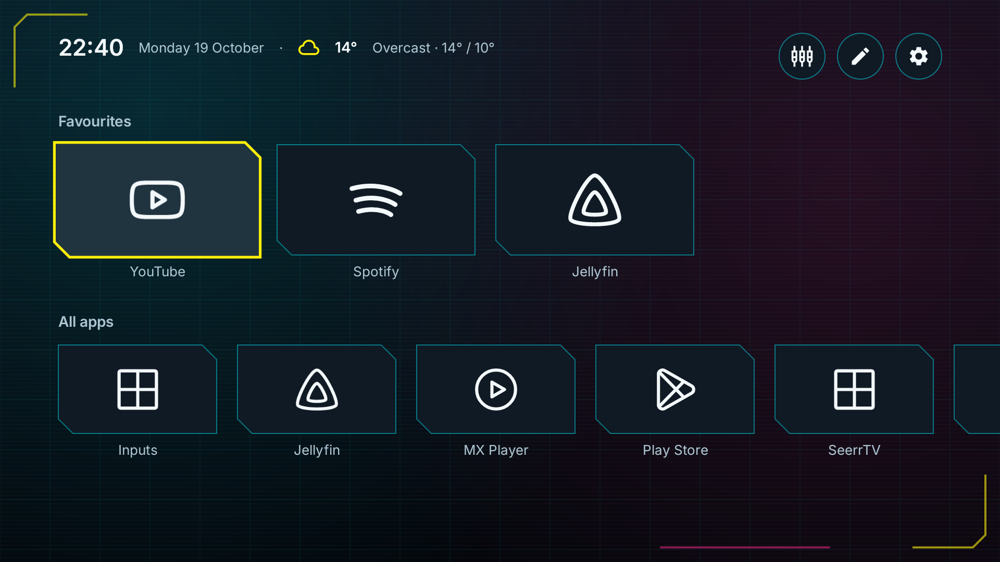

This project is under development and was previously named Plain. The application ID stays `dev.plain.launcher`, so installing an update preserves existing preferences. Earlier builds with a different application ID remain separate installations.

Some earlier screenshots retain Plain branding; the current app uses Butter Launcher.

Browse the [screenshot wiki](https://github.com/trevor-orbit-sling/butter-launcher/wiki) for setup, controls, appearance, apps and troubleshooting. The guide is also included [in this repository](wiki/Home.md); see the [wiki maintenance notes](docs/wiki-import.md) to update it.

## Why I made Butter Launcher for Android TV

I made Butter Launcher because I turned off Android TV's ads and media recommendations, but they kept showing up. Looking around, I found other people describing the same frustration. Other launchers had interesting customisation, but choices I wanted were locked behind premium tiers. I wanted a home screen I could control.

Butter Launcher has one job: launch my apps. Give me a dashboard with the time, optional weather and all my apps, then let me get back to watching. I designed it with personal media users in mind, but streaming apps work too. The name is a nod to the butter robot's “What is my purpose?” moment in *Rick and Morty*.

Make it yours. Contributions to icons, themes and the launcher itself are welcome, including support for more open-source icon packs. Get out there, have fun, and help shape a home screen you enjoy using.

## Make the TV feel like yours

- **Favourites you arrange.** Hold OK on an app, then release to open its menu. Add or remove a favourite, choose Move to reorder it, or open Android's App info.
- **All your apps in one place.** Browse your installed apps, including favourites, with a menu on every tile. Choose **Hide from All apps** to tidy this row without removing a favourite; restore individual apps in **Settings → Hidden apps**. Butter Launcher also hides its own installation and previous Plain home-screen installations.
- **Seventeen looks.** Choose familiar palettes, Cyberpunk neon or six new presets: Phosphor, Orbital, After Hours, Deep Sea, Butter and Canopy. Changing theme picks a matching accent. The six new presets also apply a matching font when selected; both remain editable. Text sizes, spacing and tile shapes are also available.
- **Backgrounds with optional motion.** Keep the theme background, add soft gradient blobs, or let them move slowly while the launcher is open.
- **Your choice of icons.** Open **Customise → Icons → Choose icons** for a visible list with previews. **Lawnicons** is recommended for its clear, consistent artwork at TV distance; **Original**, **Arcticons**, **Minimal mono** and **Desaturated** are also included. Compatible installed packs join the same list. The old hand-drawn Line choice is replaced by Lawnicons automatically. See the [icon guide](docs/icons.md) for coverage and licenses.
- **A clock and optional weather.** Weather starts off. Choose a city to enable it; there is no location permission or automatic IP lookup.
- **Remote shortcuts.** Map buttons for Customise, App options, the first row and optional Inputs while Butter Launcher is open.
- **A quick tour.** First launch explains the basics. Replay it from Settings whenever you like.


| Arcticons with Catppuccin Mocha | Lawnicons with Catppuccin Mocha |
| --- | --- |
| 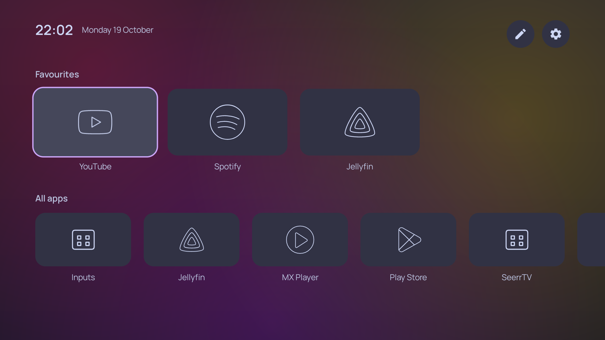 | 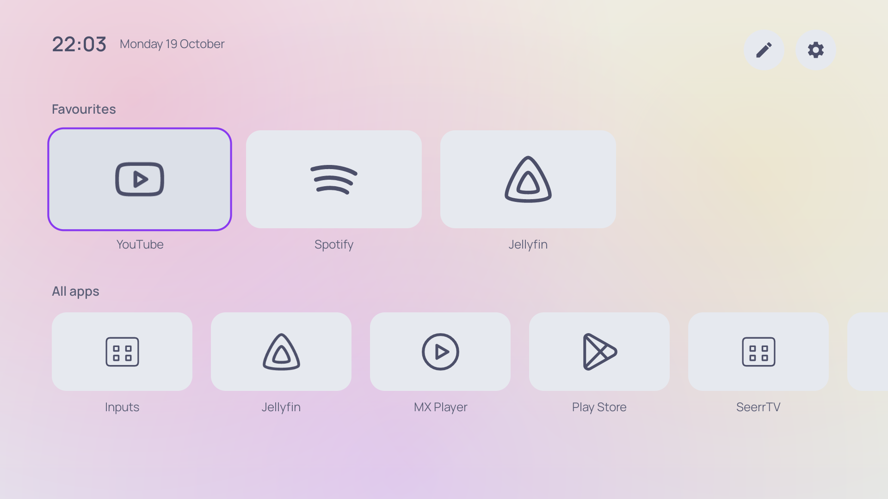 |

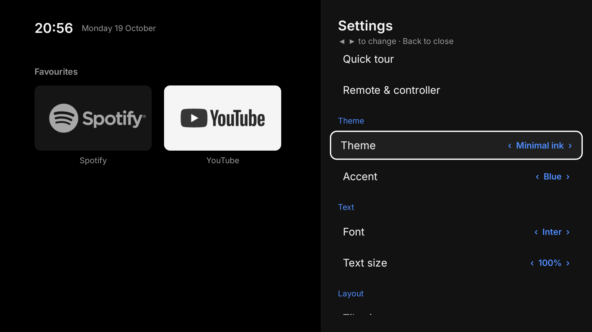

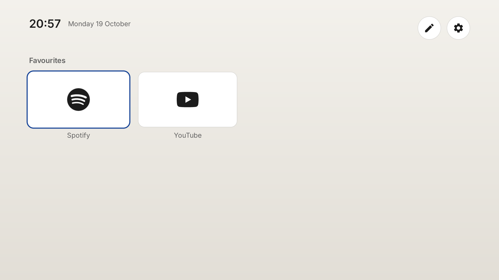

## Find your way around

| Control | Action |
| --- | --- |
| D-pad / controller directions | Move between tiles and controls |
| OK / Select | Open an app or select a control |
| Hold OK on an app, then release | Open that app's menu |
| Move in the Favourites menu | Reorder with Left/Right; OK finishes, Back stops moving |
| Menu | Open Customise with the default mapping |
| Back | Close the current panel, menu or move mode |
| Gamepad Y | App options with the default mapping |
| Gamepad Start | Return to the first row with the default mapping |

| All apps menu | Favourites menu |
| --- | --- |
| 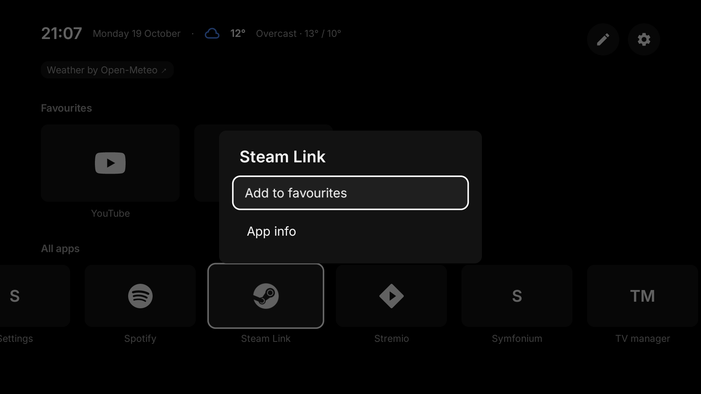 |  |

To tidy **All apps**, hold OK on an app, release, then choose **Hide from All apps**. Open **Settings → Hidden apps** and choose **Restore** beside an app to bring it back. Hiding an app keeps any favourite you already added.

| Hide from All apps | Restore a hidden app |
| --- | --- |
| 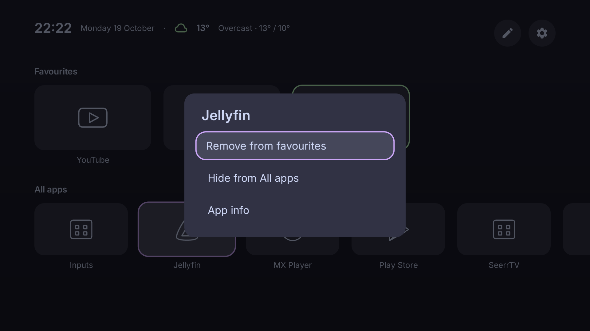 |  |

Open **Customise → Icons → Choose icons**, then move through the list to preview styles on your apps. Press OK to apply a choice or Back to cancel. A checkmark identifies the active choice; compatible installed packs appear alongside the five included styles.


Open **Customise → Remote & controller** to learn a shortcut button, resolve a conflict or reset the defaults. Navigation, OK, Back, Home, Power and volume buttons stay reserved. Mappings apply while Butter Launcher is in the foreground; system buttons and buttons your TV intercepts cannot be remapped here.

Use **Inputs** at the top of Home to open external sources exposed by your TV, such as HDMI ports. You can also assign an Inputs shortcut in Remote & controller; it starts unassigned. If your TV doesn't expose sources to apps, use its Input/Source button or the **TV settings** fallback.

| Remote shortcuts | External inputs |
| --- | --- |
| 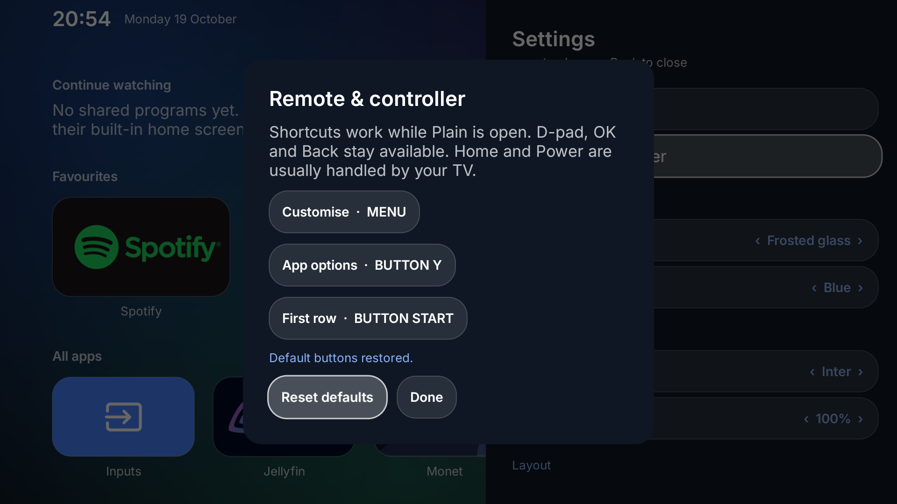 | 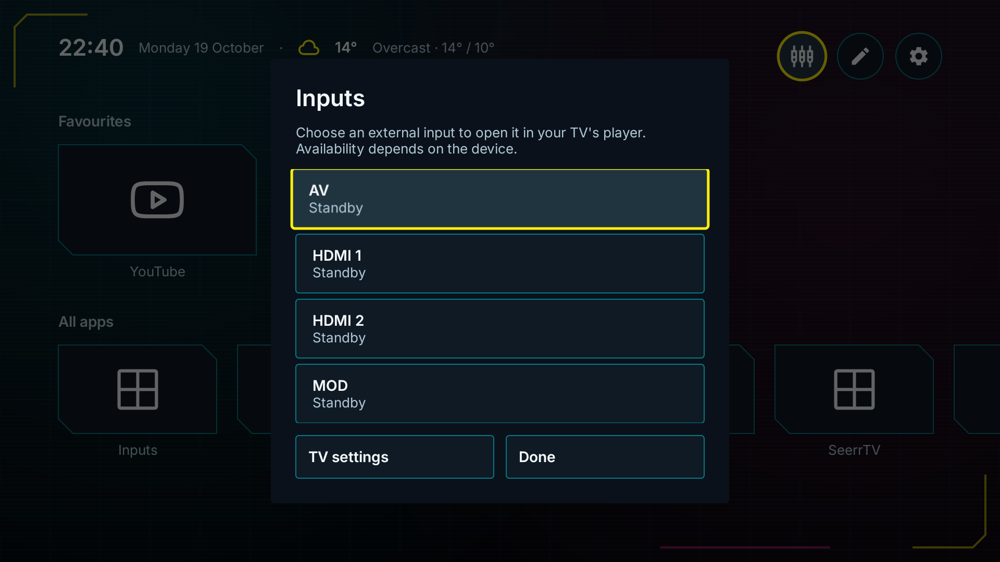 |

## Backgrounds

In **Customise**, choose **Theme**, **Gradient blobs** or **Moving blobs** for the background. Theme keeps the theme's usual background. Gradient blobs adds soft colour shapes, and Moving blobs animates them slowly. Motion runs only while the launcher is in the foreground and stops when system animations are disabled.

**Cyberpunk** adds near-black panels, neon yellow focus, cyan and magenta details, and cut-corner tiles with a faint static grid. Movement remains optional through Background. It is original styling, with no game artwork, fonts or logos.

The six new presets add their own static details, from Phosphor's amber terminal lines to Canopy's fern leaves and subtly veined tiles. Compare them in the [theme gallery](docs/theme-gallery.html), or see the [appearance guide](wiki/Appearance.md) for their font and accent defaults. Loading saved settings preserves your choices.

| Phosphor | Orbital |
| --- | --- |
| 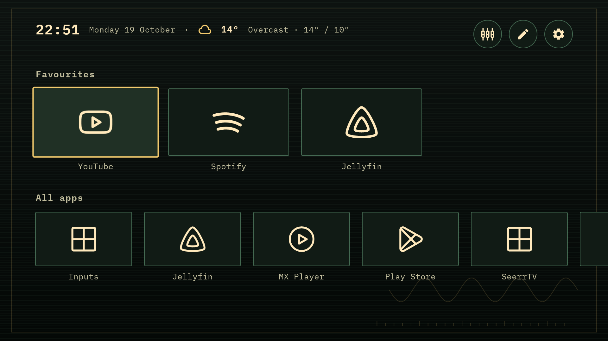 |  |

| After Hours | Deep Sea |
| --- | --- |
|  | 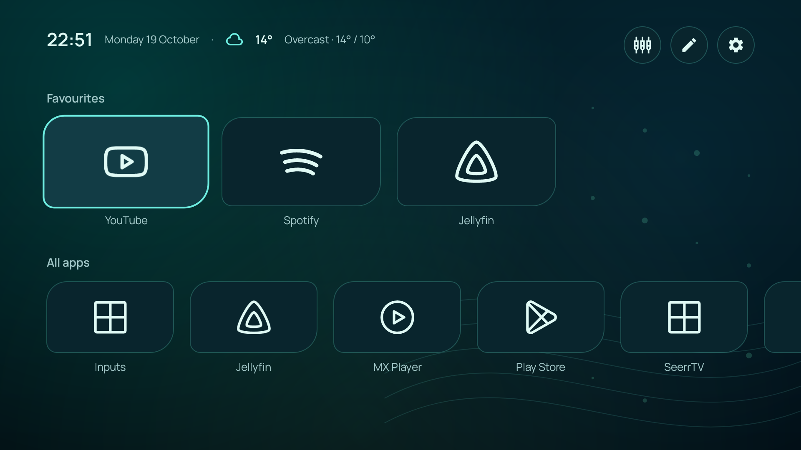 |

| Butter | Canopy |
| --- | --- |
|  | 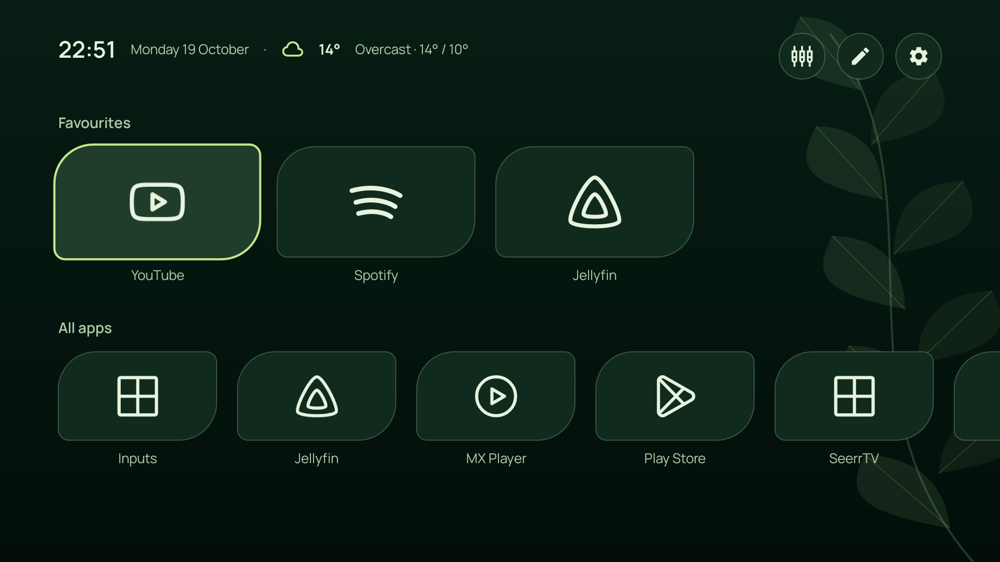 |

## Optional screen saver

**Butter bounce** puts a small Butter Launcher wordmark on a black screen. It drifts across the screen, bounces at the edges and changes between muted colours.

Open **Customise → Screen saver**, then select **Butter bounce** in your TV's screen saver settings and choose when it should run. If the device doesn't expose that screen, the shortcut opens general settings instead. Installing Butter Launcher leaves your existing screen saver and idle timing unchanged; availability depends on the TV.


## Continue watching

Butter Launcher reads Android TV's native Watch Next feed and opens programs in the app that published them. There are no service logins or hard-coded provider integrations.

Choose **Allow TV listings** in the Continue watching row and approve Android's permission prompt. This read-only permission lets Butter read searchable programs shared by participating apps, including Jellyfin's resume and next-up items. Artwork can come from HTTPS or the publishing app's own exported image provider.

**Availability depends on your TV and apps.** Apps must publish their programs to Android TV, and non-searchable/private entries remain unavailable. This is not a universal streaming watch-history aggregator.

When the device doesn't share programs, Butter Launcher explains the limitation. You can turn the row off in Customise. It requests the standard Read TV listings permission, with no privileged, notification or accessibility access. See the [review](REVIEW.md) for the platform evidence and implementation details.

## Build locally

Use **JDK 21** (JDK 17 is also supported by the project's Android plugin), the Android SDK, and platform **35**. The minimum supported version is Android **9 / API 28** on a TV device. The Gradle wrapper is included.

Set `ANDROID_HOME` to your SDK directory, or create an ignored `local.properties` containing `sdk.dir=/path/to/Android/Sdk`. Then run:

```bash
./gradlew assembleDebug testDebugUnitTest lintDebug
```

The debug APK is at `app/build/outputs/apk/debug/app-debug.apk`. Unit tests cover settings recovery, remote mapping rules, self-hiding and hide/restore, bundled icon coverage and legacy migration, chooser preferences, external inputs, themes and backgrounds, screen saver reflections, and Watch Next row and program-link safety. Lint reports are under `app/build/reports/`.

```bash
./gradlew assembleRelease
```

Release builds shrink code and resources and produce an **unsigned** APK under `app/build/outputs/apk/release/`. Configure your own release signing before distributing it. The debug key is used only for debug builds. The Android checks workflow builds debug and unsigned release APKs, runs unit tests and lint, and uploads the debug APK for testing.

## Try it on your TV

Download the APK from [Releases](https://github.com/trevor-orbit-sling/butter-launcher/releases). The current [v0.1.1 testing preview](https://github.com/trevor-orbit-sling/butter-launcher/releases/tag/v0.1.1) is debug-signed.

With ADB connected to your TV, run these commands from your download folder:

```bash
adb install -r butter-launcher-0.1.1-debug-test-only.apk
adb shell am start -n dev.plain.launcher/.MainActivity
```

Follow the quick tour. To use Butter as your home screen, choose **Home app settings** on the last page and select **Butter Launcher**, if your TV supports it.

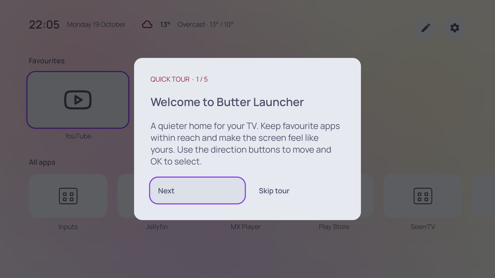

Need help connecting, updating or troubleshooting? See the [ADB guide](docs/adb.md).

## Weather and privacy

Open **Customise → Location**, type a city and choose Search. With no saved location, **Weather → Choose a city** opens the same picker. Use the D-pad and OK to select a result; choosing it enables weather. Search moves focus into the results, and Down lets you leave the text field.

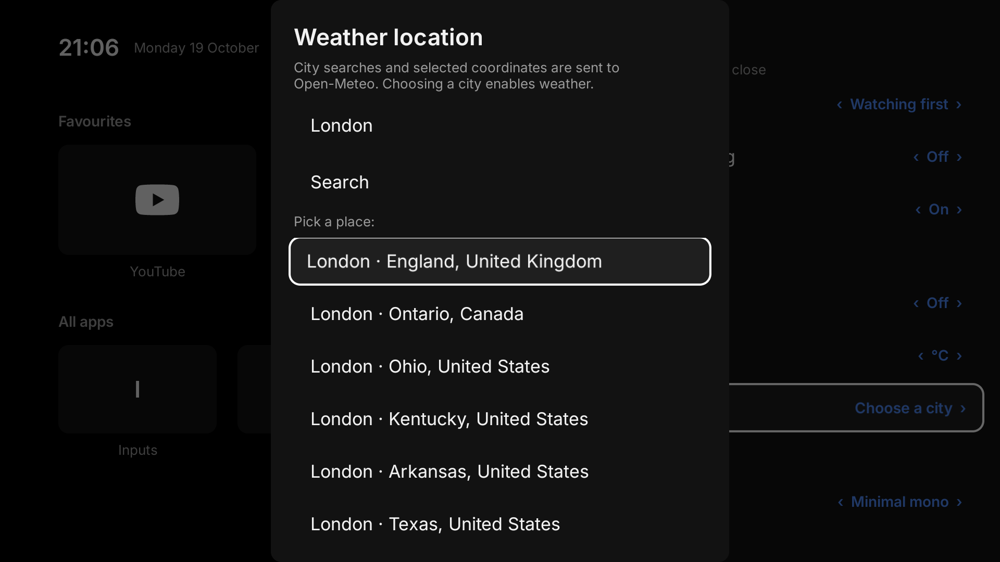

Choosing a city sends that search to Open-Meteo; enabling weather sends the selected coordinates for forecasts. Those HTTPS requests also expose your public IP address to the service. No automatic location lookup runs. Disable weather in Customise to stop forecast refreshes. Home works without internet; provider artwork and weather need their respective sources to be available.

Weather data is attributed to [Open-Meteo](https://open-meteo.com/) in **Settings → Weather** and is available under [CC BY 4.0](https://open-meteo.com/en/terms). The bundled public API endpoints are intended for non-commercial use under the service's current terms; commercial distribution should arrange appropriate service access.

## Project notes

Read the [review and verification record](REVIEW.md), [icon guide and preview](docs/icons.md), and [third-party notices](THIRD_PARTY_NOTICES.md).

A license for Butter Launcher's own source and original project artwork has not been selected. The included third-party licenses cover their respective assets and dependencies; they do not license the whole application.
