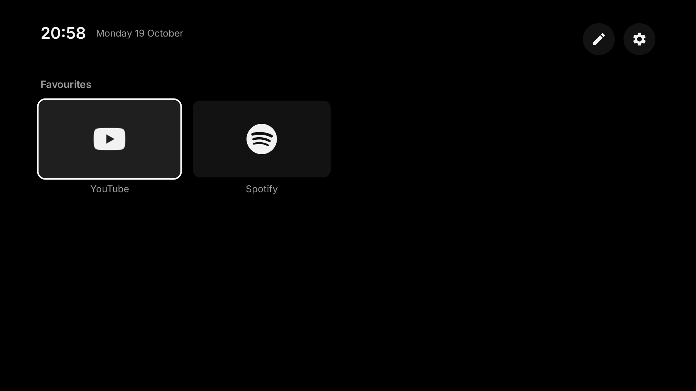
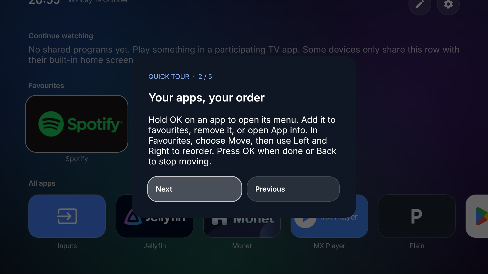
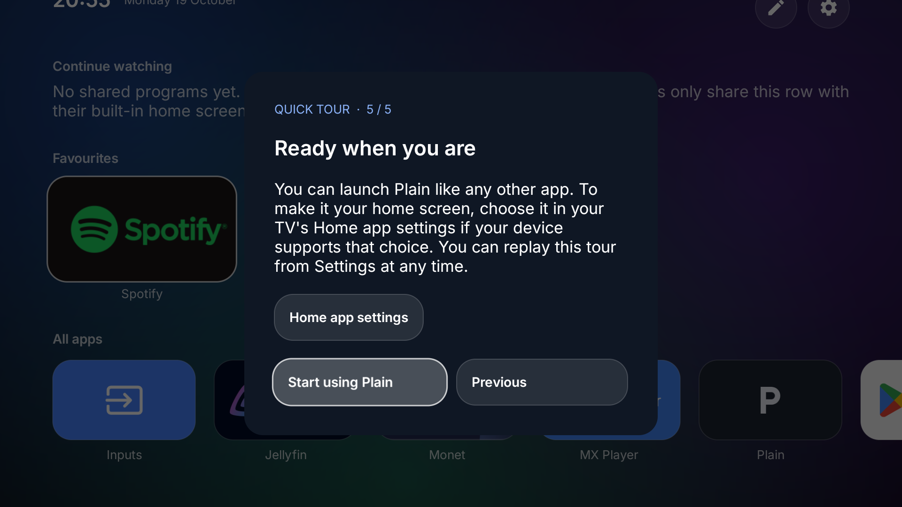

# Plain

**A quieter home for Android TV.**

Plain puts the apps you use within easy reach, with a clean layout you can make your own. Choose a theme, arrange your favourites, and get back to watching. It works with a TV remote or game controller and needs no launcher account or media-server setup.



This is a local project under development. The application ID is `dev.plain.launcher`; it installs separately from earlier personal builds and starts with fresh preferences.

## Make the TV feel like yours

- **Favourites you arrange.** Hold OK on an app to open its menu. Add or remove a favourite, choose Move to reorder it, or open Android's App info.
- **All your apps in one place.** Browse the full installed app list, including favourites, with a menu on every tile.
- **Six looks.** Frosted Glass, Material You, Ink, Paper, Slate and Sand, with accent colours, six fonts, text sizes, spacing and tile shapes.
- **Your choice of icons.** Keep app artwork, desaturate it, use minimal monochrome glyphs, or select a compatible installed icon pack.
- **A clock and optional weather.** Weather starts off. Choose a city to enable it; there is no location permission or automatic IP lookup.
- **Remote shortcuts.** Map buttons for Customise, App options and the first row while Plain is open.
- **A quick tour.** First launch explains the basics. Replay it from Settings whenever you like.


## Find your way around

| Control | Action |
| --- | --- |
| D-pad / controller directions | Move between tiles and controls |
| OK / Select | Open an app or select a control |
| Hold OK on an app | Open that app's menu |
| Move in the Favourites menu | Reorder with Left/Right; OK finishes, Back stops moving |
| Menu | Open Customise with the default mapping |
| Back | Close the current panel, menu or move mode |
| Gamepad Y | App options with the default mapping |
| Gamepad Start | Return to the first row with the default mapping |

| All apps menu | Favourites menu |
| --- | --- |
|  |  |

Open **Customise → Remote & controller** to learn a shortcut button, resolve a conflict or reset the defaults. Navigation, OK, Back, Home, Power and volume buttons stay reserved. Mappings apply while Plain is in the foreground; system buttons and buttons your TV intercepts cannot be remapped here.


## Continue watching

Plain reads Android TV's native Watch Next feed and opens programs in the app that published them. There are no service logins or hard-coded provider integrations.

**This is device dependent.** On standard AOSP TV Provider implementations, third-party apps are restricted to their own rows; Plain doesn't publish programs, so its row will normally be empty. Some devices expose shared programs to alternative home screens. Even there, only participating apps with an openable program link can appear. This is not a universal streaming watch-history aggregator.

When the device doesn't share programs, Plain explains the limitation. You can turn the row off in Customise. It never asks for privileged access, notification access or accessibility access. See the [review](REVIEW.md) for the platform evidence and implementation details.

## Build locally

Use **JDK 21** (JDK 17 is also supported by the project's Android plugin), the Android SDK, and platform **35**. The minimum supported version is Android **9 / API 28** on a TV device. The Gradle wrapper is included.

Set `ANDROID_HOME` to your SDK directory, or create an ignored `local.properties` containing `sdk.dir=/path/to/Android/Sdk`. Then run:

```bash
./gradlew assembleDebug testDebugUnitTest lintDebug
```

The debug APK is at `app/build/outputs/apk/debug/app-debug.apk`. Unit tests cover settings recovery, remote mapping rules, Watch Next row parsing and program-link restrictions. Lint reports are under `app/build/reports/`.

```bash
./gradlew assembleRelease
```

Release builds shrink code and resources and produce an **unsigned** APK under `app/build/outputs/apk/release/`. Configure your own release signing before distributing it. The debug key is used only for debug builds. An Android checks workflow is included for a future repository connection.

## Try it with ADB

Enable developer options and ADB debugging on a test TV, then approve your computer on the TV. Pair/connect using the method your device provides. Android's [ADB guide](https://developer.android.com/tools/adb) covers USB and wireless debugging.

Check the connected devices:

```bash
adb devices
```

When exactly one device is connected:

```bash
adb install -r app/build/outputs/apk/debug/app-debug.apk
adb shell am start -n dev.plain.launcher/.MainActivity
```

With several devices, add `-s DEVICE_SERIAL` after `adb` for each command. On first launch, follow the quick tour or choose Skip tour. Reopen it through **Customise → Quick tour**.


The tour walks through app menus, reordering and remote controls:



To use Plain as your regular home screen, the final tour page opens the TV's Home app settings, with a fallback to system settings. Choose Plain yourself if the device offers that option. Some manufacturers don't support changing the home app. Opening or installing Plain does not automatically replace your current home screen.



To capture the current screen for your own notes:

```bash
mkdir -p captures
adb shell screencap -p /sdcard/plain-screen.png
adb pull /sdcard/plain-screen.png captures/plain-screen.png
adb shell rm /sdcard/plain-screen.png
```

This file-and-pull method also works on devices that print diagnostic text before screenshot bytes. `captures/` is ignored by Git. Check captures for private app names, titles, account details and network information before sharing. For troubleshooting, inspect only this app's logs:

```bash
adb shell pidof dev.plain.launcher
adb logcat --pid=APP_PID
```

Replace `APP_PID` with the value from the first command. To remove the local test installation:

```bash
adb uninstall dev.plain.launcher
```

## Weather and privacy

Open **Customise → Location**, type a city and choose Search. Use the D-pad and OK to select a result; choosing it enables weather. Search moves focus into the results, and Down lets you leave the text field.


Choosing a city sends that search to Open-Meteo; enabling weather sends the selected coordinates for forecasts. Those HTTPS requests also expose your public IP address to the service. No automatic location lookup runs. Disable weather in Customise to stop forecast refreshes. Home works without internet; provider artwork and weather need their respective sources to be available.

Weather data is attributed to [Open-Meteo](https://open-meteo.com/) in the interface and is available under [CC BY 4.0](https://open-meteo.com/en/terms). The bundled public API endpoints are intended for non-commercial use under the service's current terms; commercial distribution should arrange appropriate service access.

## Project notes

Read the [review and verification record](REVIEW.md), [icon-pack recommendation](docs/icons.md), and [third-party notices](THIRD_PARTY_NOTICES.md).

A license for Plain's own source has not been selected. The included third-party licenses cover their respective assets and dependencies; they do not license the whole application.
