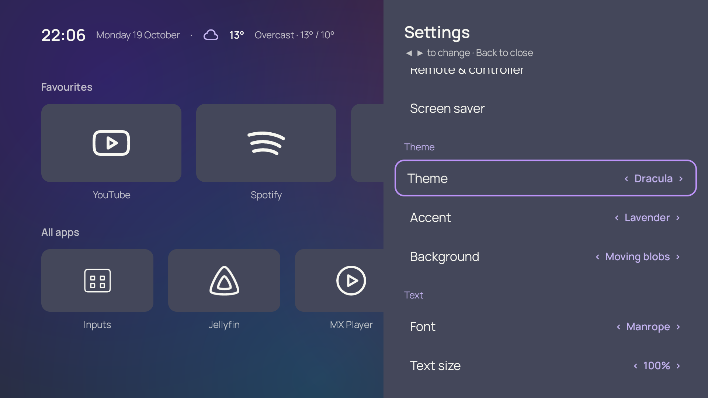
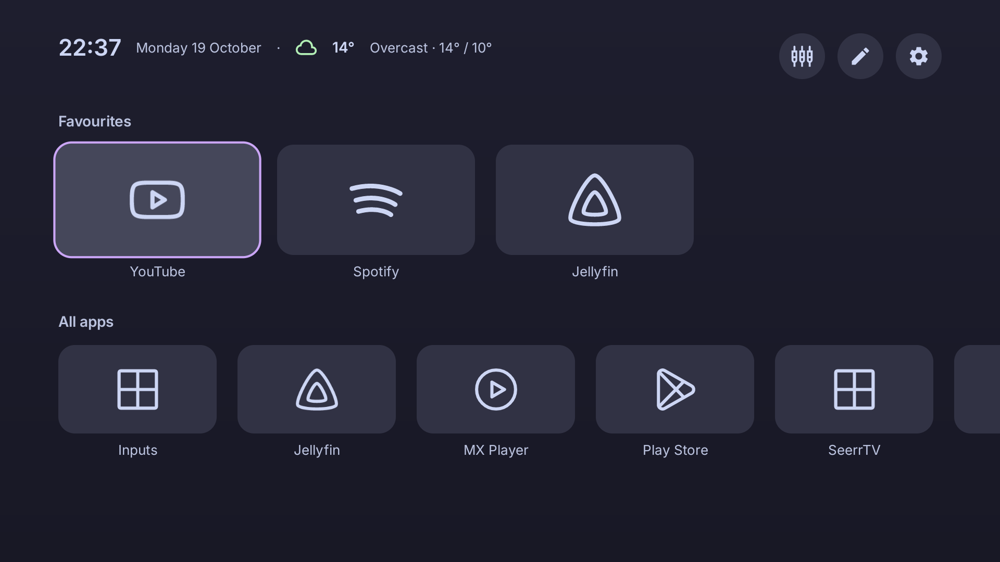

# Make it yours

Open **Customise** with the top-right control or Menu on your remote.

Choose from eleven themes: Frosted Glass, Material You, Ink, Paper, Slate, Sand, Catppuccin Mocha, Catppuccin Latte, Dracula, Nord and Cyberpunk. Changing theme chooses a matching accent. You can then choose a different accent yourself.

Adjust fonts, text size, tile size and shape, spacing, app names and row order in the same panel.

For **Background**, choose:

- **Theme** for the theme's usual background.
- **Gradient blobs** for soft static colour shapes.
- **Moving blobs** for slow movement while Butter Launcher is in the foreground. Motion stops when system animations are disabled.

**Cyberpunk** pairs near-black panels with neon yellow focus and cyan/magenta details. Its usual rounded tile setting uses cut corners; Square and Pill remain available. The faint grid and scanlines are static, with no flicker. Movement stays opt-in through Background.

This is an original preset inspired by neon sci-fi styling. It contains no game artwork, fonts or logos and is not affiliated with Cyberpunk 2077.

Weather starts off. Open **Location**, search for a city and select a result with the D-pad and OK. Choosing a location enables weather; disable **Weather** to stop forecast refreshes. The Weather section includes the Open-Meteo attribution.

City searches and selected forecast coordinates are sent to Open-Meteo over HTTPS. There is no automatic IP-location lookup or location permission request.

[[Apps-and-icons|Next: choose icons]]
