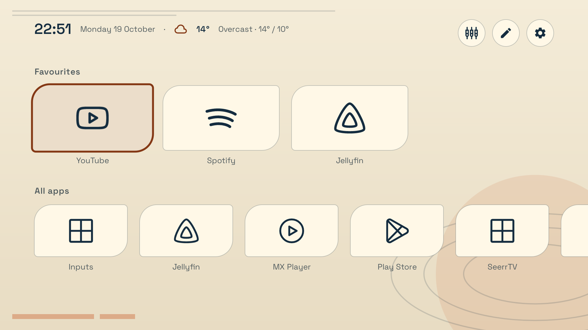
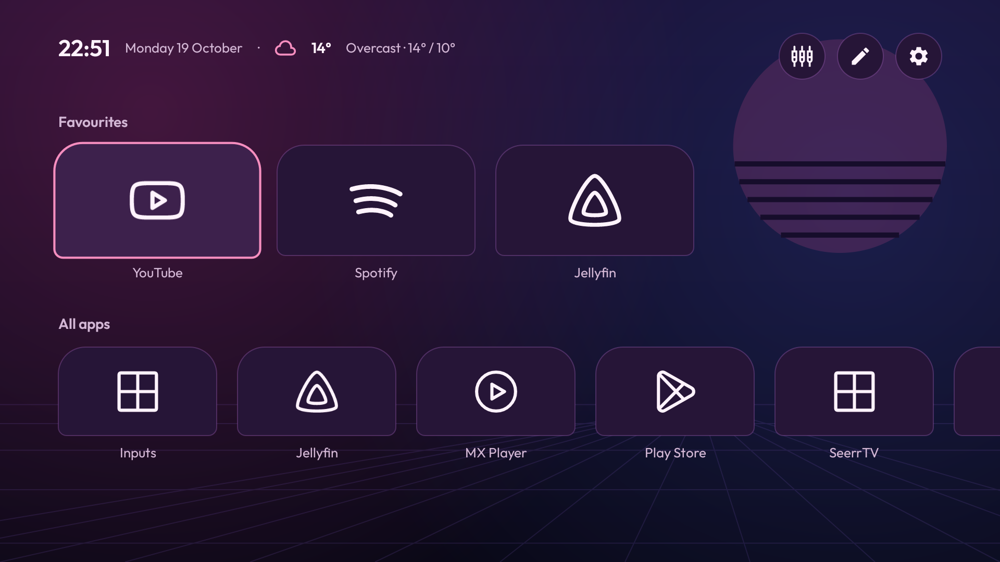
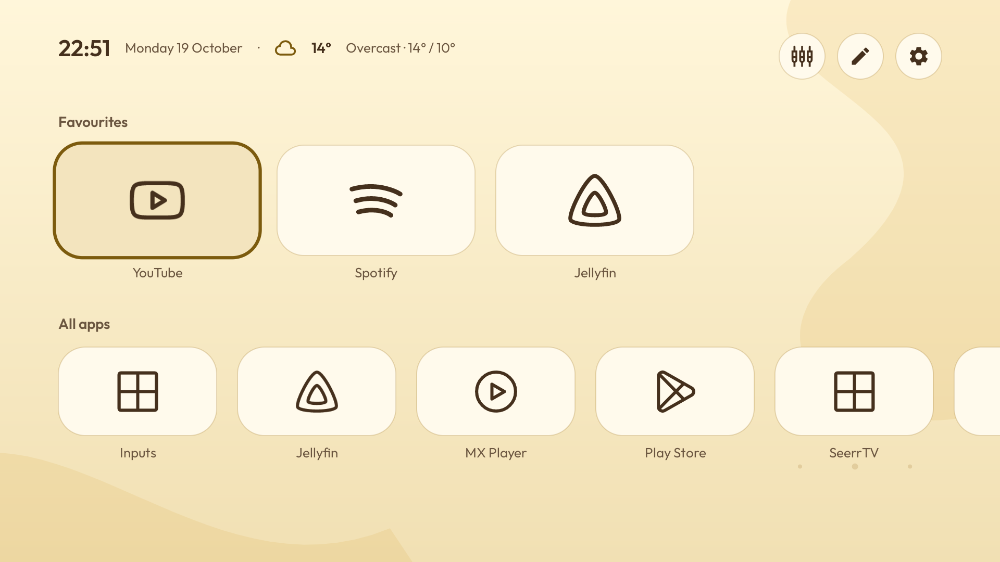
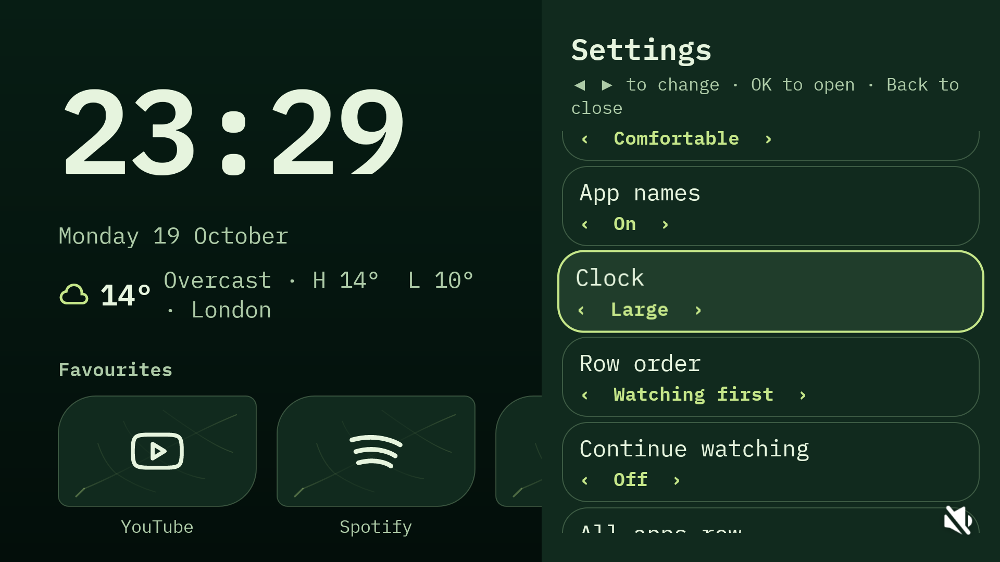

# Make it yours

Open **Customise** with the top-right control or Menu on your remote.

Choose from seventeen themes: Frosted Glass, Material You, Ink, Paper, Slate, Sand, Catppuccin Mocha, Catppuccin Latte, Dracula, Nord, Cyberpunk, Phosphor, Orbital, After Hours, Deep Sea, Butter and Canopy. Changing theme chooses a matching accent. You can then choose a different accent yourself.

The six new presets also apply a matching font when you switch to them. You can change that font afterward. Loading saved settings or selecting the current theme again keeps your custom font and accent; the earlier eleven themes keep your font when selected.

| Theme | Look | Font | Accent |
| --- | --- | --- | --- |
| Phosphor | Charcoal and amber terminal lines | Plex Mono | Amber |
| Orbital | Ivory, navy and orange with orbit details | Space Grotesk | Copper |
| After Hours | Purple, pink and blue with a striped sunset | Outfit | Hot pink |
| Deep Sea | Dark teal contours and bioluminescent dots | Manrope | Teal |
| Butter | Cream, gold and cocoa with melting curves | Outfit | Amber |
| Canopy | Sage and moss with fern leaves, tile veins and short stems | Manrope | Lime |

Their details are static. Background movement stays optional through **Background → Moving blobs**.

| Phosphor | Orbital |
| --- | --- |
|  |  |

| After Hours | Deep Sea |
| --- | --- |
|  |  |

| Butter | Canopy |
| --- | --- |
|  |  |

Adjust fonts, text size, tile size and shape, spacing, app names and row order in the same panel.

The **Large** clock fits its complete time to the available space, including while Settings is open. Its font stays the one you selected; the time scales down when needed. Canopy adds subtle veins and a short stem to app tiles while keeping their icons clear.

For **Background**, choose:

- **Theme** for the theme's usual background.
- **Gradient blobs** for soft static colour shapes.
- **Moving blobs** for slow movement while Butter Launcher is in the foreground. Motion stops when system animations are disabled.

**Cyberpunk** pairs near-black panels with neon yellow focus and cyan/magenta details. Its usual rounded tile setting uses cut corners; Square and Pill remain available. The faint grid and scanlines are static, with no flicker. Movement stays opt-in through Background.

This is an original preset inspired by neon sci-fi styling. It contains no game artwork, fonts or logos and is not affiliated with Cyberpunk 2077.

Weather starts off. Open **Location**, or **Weather → Choose a city** when no location is saved, then search and select a result with the D-pad and OK. Choosing a location enables weather; disable **Weather** to stop forecast refreshes. The Weather section includes the Open-Meteo attribution.

City searches and selected forecast coordinates are sent to Open-Meteo over HTTPS. There is no automatic IP-location lookup or location permission request.

[[Apps-and-icons|Next: choose icons]]
