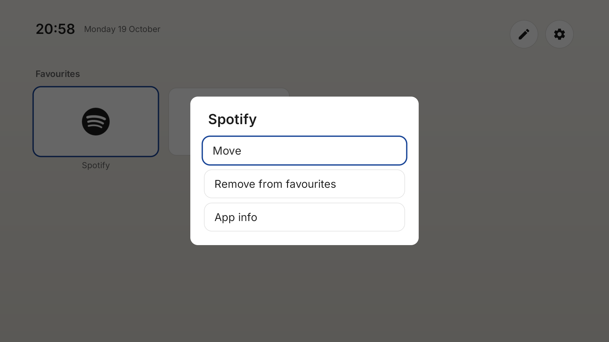
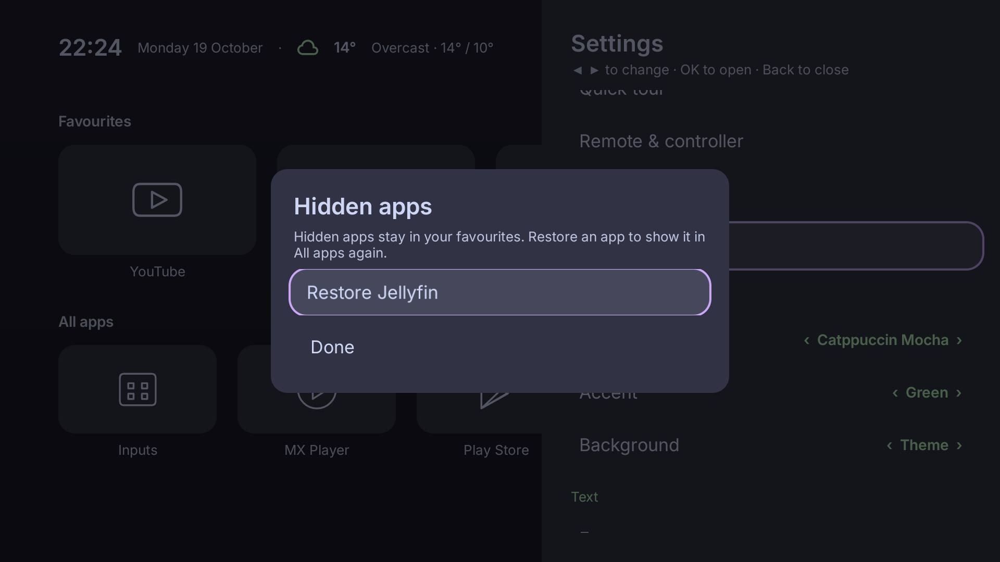
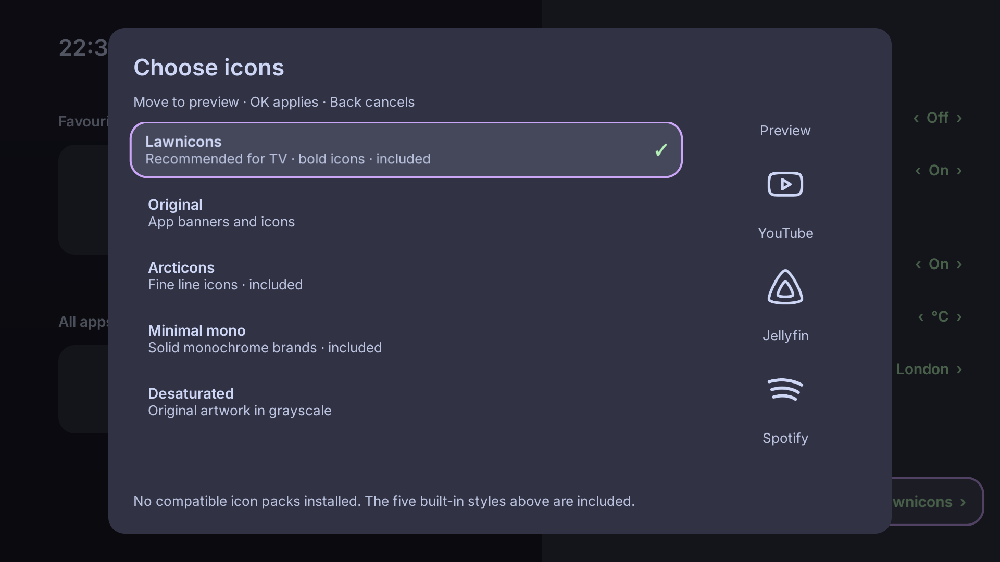
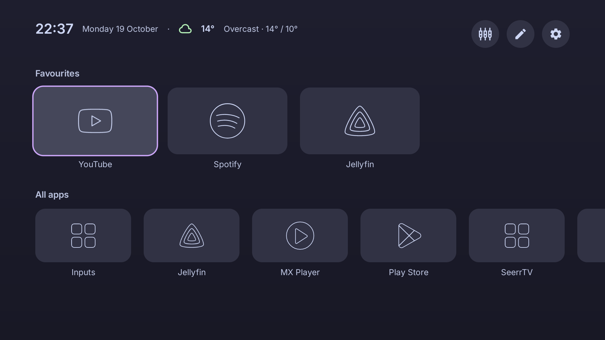

# Apps and icons

Hold OK on an app, then release to open its menu. Choose **Add to favourites**, or remove an existing favourite. In the Favourites menu, choose **Move**, use Left/Right to reorder, then OK to finish or Back to stop moving.

To tidy **All apps**, open an app's menu there and choose **Hide from All apps**. It stays in Favourites if you already added it. Open **Settings → Hidden apps** and select **Restore** for any app you want back. Even when every app is hidden, Settings remains available.

| Hide an app | Restore a hidden app |
| --- | --- |
|  |  |

Butter Launcher hides its own installation and previous Plain home-screen installations automatically.

Open **Customise → Icons → Choose icons** to see the five included choices and any compatible installed packs together:

| Included choice | Look |
| --- | --- |
| Lawnicons (recommended) | Bold monochrome artwork |
| Original | App banners and icons |
| Arcticons | Fine outline artwork |
| Minimal mono | Solid monochrome brands |
| Desaturated | Original artwork in grayscale |

Move through the list to preview icons on your visible installed apps. OK applies; Back cancels. A checkmark marks the current choice. The built-in choices need no separate installation. Unsupported apps use a standard fallback icon.

| Arcticons | Lawnicons |
| --- | --- |
|  |  |

Compatible installed packs are discovered automatically. If a selected pack is no longer available, choose an included style from the same list.

Upgrading from the retired Line icons choice selects Lawnicons and preserves your other preferences.

[[Appearance|More appearance options]]
