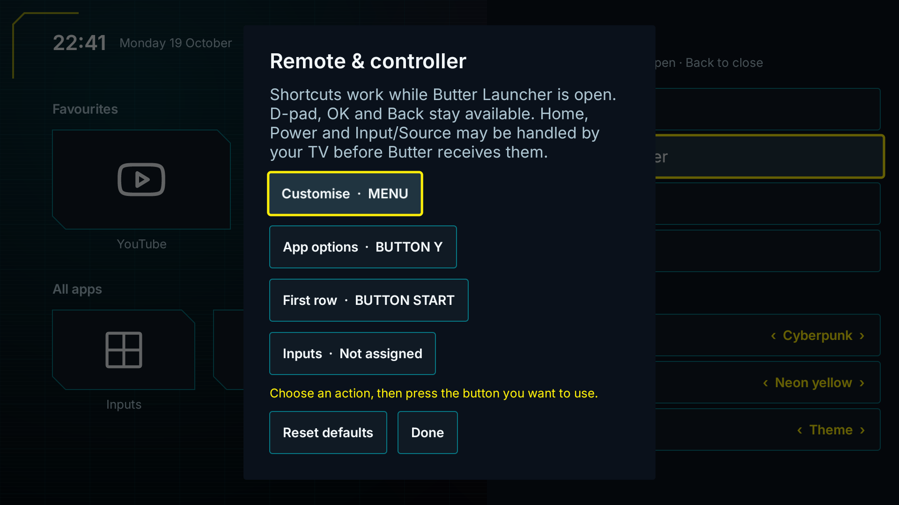

# Remotes and TV inputs

Use the direction buttons to move and OK to select. Hold OK on an app, then **release** to open its menu.

| Control | Default action |
| --- | --- |
| D-pad or controller directions | Navigate |
| OK / Select | Open an app or select a control |
| Hold OK, then release | Open the app menu |
| Menu | Open Customise |
| Back | Close a panel, menu or move mode |
| Gamepad Y | Open app options |
| Gamepad Start | Return to the first row |

Open **Customise → Remote & controller** to learn a button for a shortcut, resolve conflicts or restore the defaults.

Navigation, OK, Back, Home, Power and volume stay reserved. Shortcuts work while Butter Launcher is open. Buttons intercepted by the TV remain under the TV's control; an ADB-injected gamepad event does not establish support for every physical controller.

Select the small plug-shaped **Inputs** control at the top of the home screen to see external ports your TV exposes, such as HDMI sources. Each shows its connection status; select one to open it in the TV's player. If no ports are available, use **TV settings** or your remote's Input/Source button.

You can assign an **Inputs** shortcut through **Remote & controller**. It starts as **Not assigned**, so existing remote mappings stay as they are. The TV may handle its physical Input/Source button before Butter receives it; choose another available button if needed.

Port availability and switching support vary by TV. This list covers external sources, rather than a live-channel guide.

[[Apps-and-icons|Next: organise your apps]]
